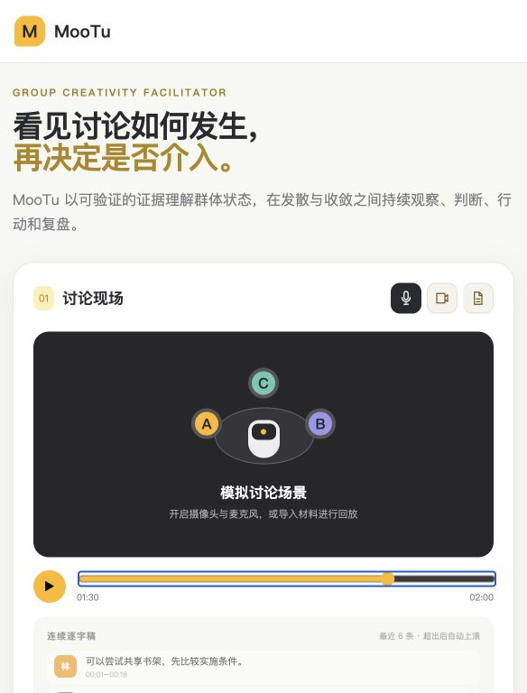

# 实际验证记录

日期：2026-10-27（Asia/Shanghai）。

- `npm run check`：全部 JavaScript 语法检查通过。
- `npm test`：18 项活动回归检查通过；faux provider 仅模拟工具协议。
- `npm run eval`：12 个合成会话、21 个标签点，全部执行；0 次动作约束违规；阶段准确率 18/21，3 个语义收敛点失败并保留。其余指标与始终观察基线见 `eval/results/rule/report.json`，不构成真实模型能力或真实用户效果证据。
- `npm run build`：独立副本成功打包，未复制部署身份、未发布。
- 本机 HTTP smoke：`/api/status` 明确 fallback；`/api/analyze` 对合成会话返回有效规则判断，识别沉默成员；非法时间返回 400；回放速度配置为 1。
- 本机浏览器：研究副本正确显示 3 位成员 / 3 个 Pod，时间轴为 2 分钟；拖动到 01:30 后显示“保持观察”，MuJoCo 渲染正常。
- 初始验证未调用真实模型；后续已完成一轮 DeepSeek 实际调用，12 个决策会话、63 个时间窗，全部执行成功。常规组 5/6，语义挑战 6/6，未观察到动作约束违规。未招募人工标注者，未执行真实小组实验。详细比较见 `eval/COMPARISON.md`。

## 后续重复与整场输入检查

12 个决策用例累计三轮，30/36 次符合预期，7/12 个用例三轮都符合；执行失败 0。18 个标注点中 12 个三轮决策元组完全一致。没有调整核心策略、输入或预期以迎合结果。

额外输入 15 分钟、4 人、60 条发言，实际模型输出 31 条决策，0–900 秒时间轴验证通过。规则输出同时通过追加未来不改写过去、观察仅用已完成发言的检查。整场样例只有一次模型运行，没有人工质量金标准。
